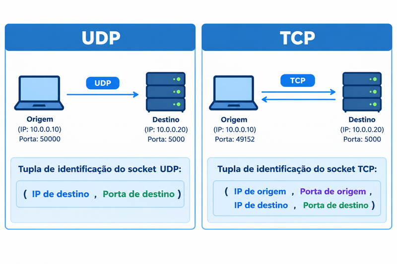
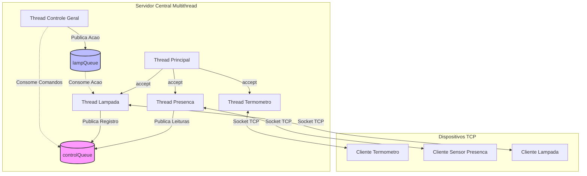
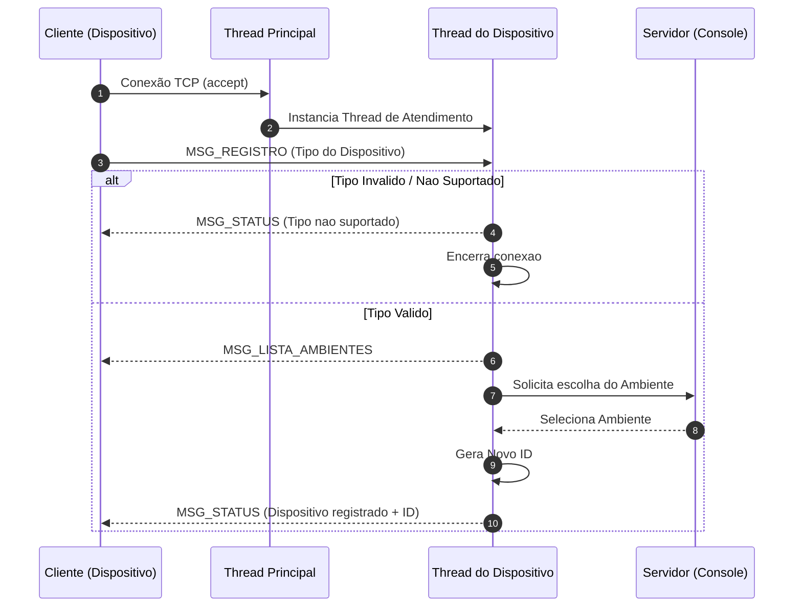
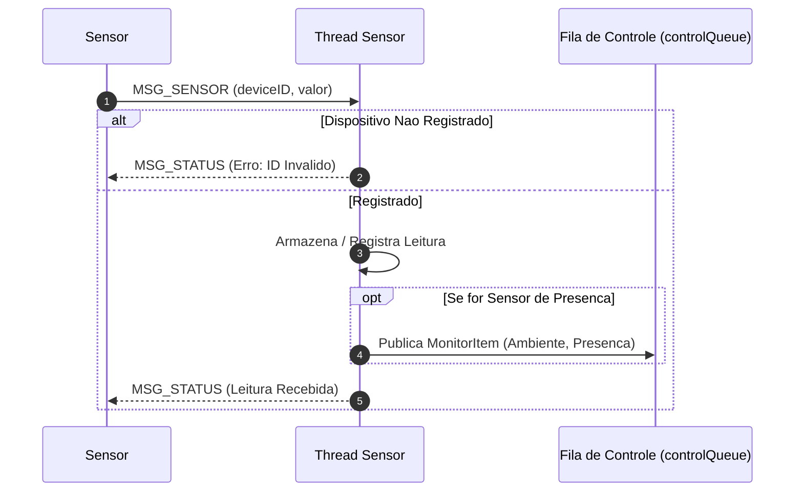
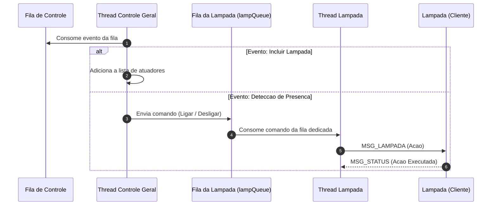

# 1. Fundamentos de Sockets TCP

## 1.1. Conceito e Funcionamento do Socket TCP
Um socket atua como uma interface de software (API) entre o processo de aplicação e a camada de transporte dentro de um hospedeiro, funcionando de maneira análoga a uma porta por onde as mensagens entram e saem da rede. O protocolo TCP é orientado a conexão, o que exige que o cliente e o servidor realizem um processo de apresentação inicial em três etapas (three-way handshake) para estabelecer os parâmetros antes do envio dos dados da aplicação.
<div align="center">
  
</div>
A conexão resultante é full-duplex, dados podem fluir em ambas as direções simultaneamente, e ponto a ponto.
Enquanto um socket UDP é identificado por uma tupla de dois elementos (IP de destino e porta de destino), um socket de conexão TCP é identificado de forma única por uma tupla de quatro elementos: endereço IP de origem, porta de origem, endereço IP de destino, porta de destino.
<div align="center">
  
</div>

## 1.2. Funcionamento do Buffer TCP e Controle de Fluxo

Ao estabelecer uma conexão TCP, cliente e servidor alocam recursos contendo variáveis de estado e buffers de envio e de recepção. Quando o processo de aplicação escreve dados no socket, os bytes são depositados no buffer de envio do TCP. O TCP retira pedaços de dados desse buffer conforme sua própria conveniência e os empacota em segmentos limitados pelo Tamanho Máximo do Segmento (*Maximum Segment Size* - MSS).

Como o TCP opera estritamente orientado a um fluxo contínuo de bytes (*byte stream*) sem fronteiras inerentes de mensagens, ele não garante que um único `send()` na origem resulte em exatamente um `recv()` correspondente no destino. Desse modo, pacotes enviados podem sofrer **fragmentação** (chegando divididos em múltiplos segmentos) ou **agrupamento/concatenação** (chegando colados no mesmo segmento de rede).

Para contornar essa característica da camada de transporte e garantir a integridade do protocolo, o sistema implementa um mecanismo de controle de fluxo e desempacotamento baseado em buffer de aplicação, estruturado nas funções `ReceiveMessage` e `getMessage` presentes no arquivo `Message.py`:

### 1.2.1. O Acumulador de Rede (`ReceiveMessage`)
Esta função gerencia a interface com o socket e garante que a aplicação nunca perca dados parciais. Caso os dados cheguem incompletos, ela acumula os novos blocos binários ao buffer anterior (`device.buffer = device.buffer + dataBin`):

```python
def ReceiveMessage(connection, device):
        print('>>> Aguardando mensagem')
        msg = None
        # Se o buffer ainda está vazio, aguarda chegada de dados
        if not device.buffer or len(device.buffer) == 0:
                device.buffer = connection.recv(TAM_BUFFER)
        while True:
                print('>>> Decodificando mensagem...')
                if device.buffer and len(device.buffer) > 0:
                        msg, device.buffer = getMessage(device.buffer)
                # Se chegou uma mensagem completa, retorna o objeto
                if msg != None:
                        return msg
                # Se a mensagem estava incompleta, lê mais dados da rede
                dataBin = connection.recv(TAM_BUFFER)
                if not dataBin:
                        connection.close()
                        break
                # Adiciona novos dados ao buffer (tratando a fragmentação)
                device.buffer = device.buffer + dataBin
        return None
```

### 1.2.2. O Extrator e Fatiador de Mensagens (getMessage)
Uma vez que os dados estão acumulados no buffer, esta função realiza o trabalho cirúrgico de delimitação e extração. Ela lê o primeiro byte (buffer[:1]) para identificar o código da mensagem e consulta uma tabela de tamanhos fixos (msgsSize) — ou calcula dinamicamente o tamanho caso seja uma mensagem de lista de ambientes (MSG_LISTA_AMBIENTES).

Se o buffer contiver menos bytes do que o necessário, a função retorna None e preserva o estado atual, aguardando novas leituras. Caso contrário, ela fatia exatamente a porção da mensagem (buffer[:msgSize]), preserva o excedente no buffer (buffer = buffer[msgSize:]) para evitar perdas por agrupamento de pacotes, e executa o unpack dos dados:

```python
def getMessage(buffer):
        msg = None
        codeBin = buffer[:1]
        if len(codeBin) == 1:
                code, = struct.unpack('!B', codeBin)
                if code >= 1 and code <= 6:
                        # Tamanho fixo de cada tipo de mensagem
                        msgsSize = [15, 10, 11, 11, 17, 14]
                        msgSize = msgsSize[code-1]
                        
                        # Tratamento para mensagens de tamanho variável (Lista de Ambientes)
                        if code == MSG_LISTA_AMBIENTES:
                                cod, dat, countRooms = struct.unpack('!BdH', buffer[:11])
                                msgSize += countRooms * 22

                        # Se o buffer tem menos bytes que o necessário, aguarda mais dados
                        if len(buffer) < msgSize:
                                return None, buffer

                        # Isola a mensagem atual e preserva o restante no buffer
                        msgData = buffer[:msgSize]
                        buffer = buffer[msgSize:]
                        
                        # Decodifica os bytes isolados
                        msg.unpack(msgData)
                else:
                        buffer = buffer[1:]
        return msg, buffer
```

Esse design assegura que a aplicação saiba lidar perfeitamente com a volatilidade do buffer TCP, interpretando o fluxo contínuo de forma estruturada, síncrona e segura.

## 2.1. Arquitetura e Diagramas de Fluxo

O sistema adota uma arquitetura concorrente baseada em **múltiplas threads (*multithread*)** e **filas de mensagens (*queues*)**, desacoplando a recepção de dados de rede da lógica de automação da residência.

---

### 2.1.1. Visão Geral da Arquitetura e Troca de Mensagens

O diagrama abaixo ilustra como as threads do servidor se comunicam entre si e com os dispositivos externos através de conexões TCP e filas (*queues*):



## 2.2. Fluxogramas das Operações do Sistema

### 2.2.1. Inicialização do Cliente e Handshake no Servidor
Quando um novo dispositivo se conecta, ocorre a validação do tipo, a escolha do ambiente no console do servidor e a geração do ID:



### 2.2.2. Fluxo de Leitura dos Sensores (Temperatura e Presença)
Os sensores enviam periodicamente suas medições ao servidor, que atualiza o estado e/ou repassa o evento para a Fila de Controle:



### 2.2.3. Fluxo da Thread de Controle Geral e Acionamento de Lâmpadas
A Thread de Controle Geral processa os eventos recebidos e aciona as lâmpadas correspondentes através das suas filas dedicadas:




